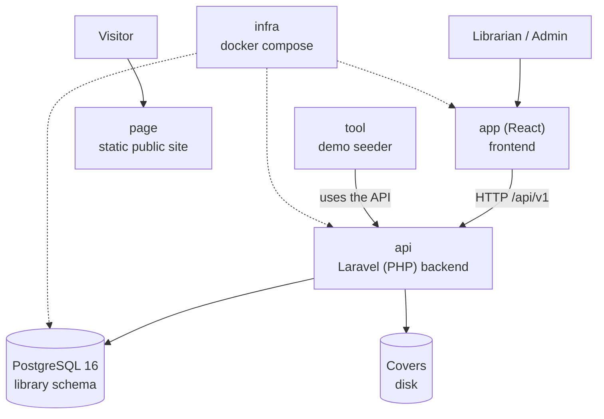

# Architecture at a glance — Manager Library (React + Laravel)

Five minutes before opening everything else. Details are in [`architecture.md`](architecture.md).

## The system in one picture

## The six repositories and their role

| Repo | Role | Tested with |
|---|---|---|
| `docs` | The specification (spec-python, spec-.net, and this spec-php translation) | Whether this reading is enough to build the system |
| `api` | Business rules and HTTP contract in Laravel | Domain, service, contract and concurrency tests |
| `app` | Operator screens in React | End-to-end walkthrough: login → lend → return → report |
| `page` | Public presentation, never calls the API | Looks right on mobile and desktop |
| `infra` | `docker compose up` and the empty engine | Boots with a single command |
| `tool` | Demo data (books, members, loans) | The demo has real data to show |

## The five ideas behind the design

1. **A loan is an immutable fact**; only an item's `returnedAt` changes.
2. **Copies are withdrawn and restocked inside the same operation** that creates or closes the item.
3. **Status is computed**: `open`, `overdue` and `closed` are not stored columns.
4. **Frozen values do not follow the catalog**: October's report does not change because a book is renamed in November.
5. **The database is the last line of defense**: if the copies `CHECK` fires, something wrote outside the system.
