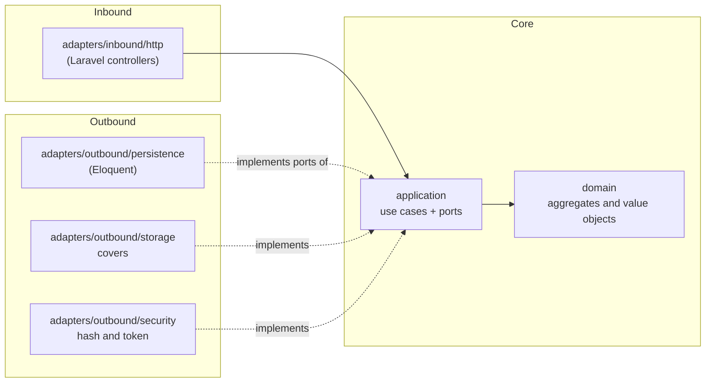
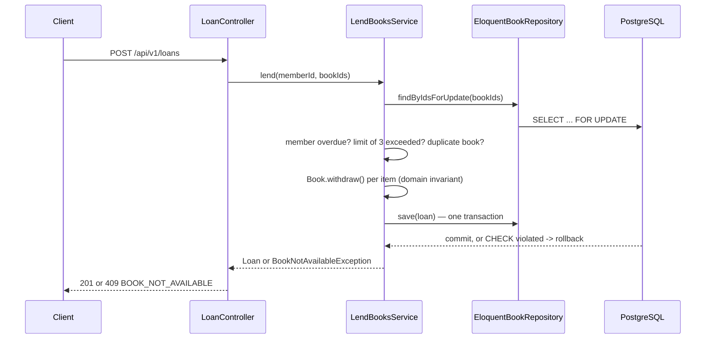

# Architecture — Manager Library (React + Laravel)

**Hexagonal** architecture (ports and adapters), same as the reference spec. The dependency rules are
Articles I to III of [`constitution.md`](constitution.md).

## 1. Layers and dependencies



Dependency arrows point **inward**. `bootstrap` is the only layer that sees both halves.

## 2. Folder structure

```text
src/Library/
├── domain/              # Book, Loan, LoanItem, Member, User; Isbn, Quantity, DateRange
│   └── exceptions/      # one class per api-contract.md error code
├── application/
│   ├── ports/outbound/  # BookRepository, LoanRepository, MemberRepository, UserRepository,
│   │                    # ReportReader, Clock, PasswordHasher, TokenIssuer, CoverStorage
│   └── services/        # LendBooksService, ReturnItemService, CreateBookService, SearchBooksService,
│                        # OverdueService, MostBorrowedReportService, LoginService, CreateLibrarianService
├── adapters/
│   ├── inbound/http/    # controllers, request validation, error handling
│   └── outbound/
│       ├── persistence/ # Eloquent models + repository implementations
│       ├── storage/      # DiskCoverStorage
│       └── security/     # BcryptPasswordHasher, SanctumTokenIssuer
└── bootstrap/composition/   # the single composition point
```

A dedicated `Library\` PSR-4 namespace (`composer.json`) maps to `src/Library/`, separate from Laravel's own
`App\` namespace in `app/` (which keeps only what Laravel itself needs to boot: providers, routes, config —
glue, not business code).

## 3. Aggregates (invariants they defend)

| Entity | Invariants |
|---|---|
| `Book` | `available_copies` between 0 and `total_copies`; `total_copies` ≥ 1; soft delete via `deletedAt` |
| `Loan` + `LoanItem` | 1 to 3 items; no repeated book; 14-day due date; immutable except `returnedAt` |
| `Member` | document number required and unique |
| `User` | normalized username (lowercase, trimmed); role in (`admin`, `librarian`) |

`LendBooksService` withdraws the copy and creates the item **in a single transaction** (`DB::transaction`),
with `lockForUpdate()` on the book row to resolve the last-copy race (ADR-002).

## 4. Flow: register a loan



## 5. Errors

Services and entities throw their own domain exceptions (`BookNotAvailableException`,
`MemberHasOverdueException`, `MemberLimitExceededException`, ...), all extending `DomainException` with a
`code()` and `statusCode()`. A central exception handler (`bootstrap/app.php` → `withExceptions`) translates
them to the single error body from `api-contract.md`. A raw framework error (Eloquent, validation) never
reaches the client.

## 6. What is not here

No queues, no cache, no microservices, no multi-tenancy — same as the reference spec. Added only if a
requirement asks for it, not before.
