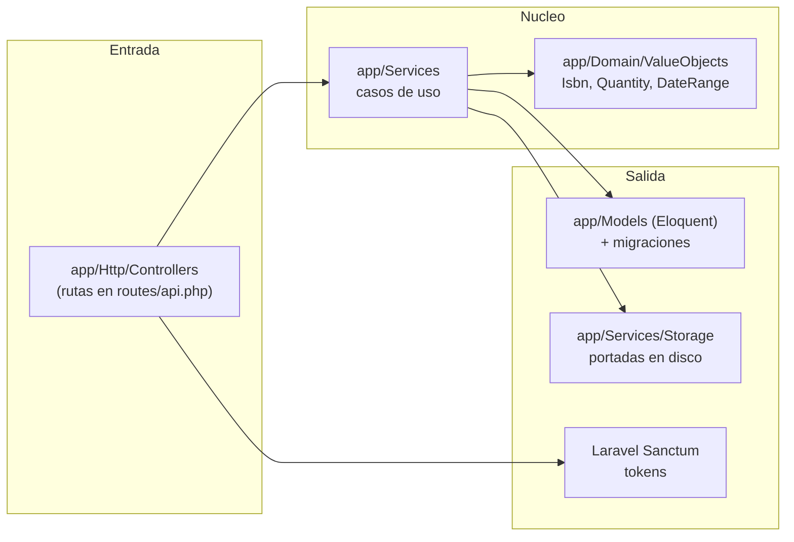
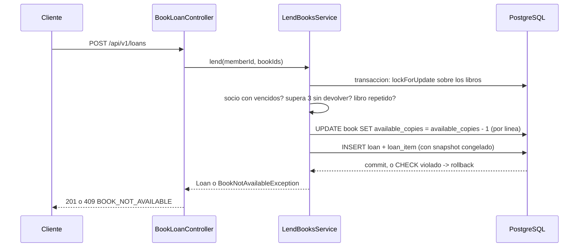

# Arquitectura — Manager Library (React + Laravel)

Arquitectura por capas con dirección de dependencia hacia adentro, igual en espíritu a la hexagonal del spec de
referencia (artículos I-III de [`constitution.md`](constitution.md)), adaptada a cómo se trabaja idiomáticamente
en Laravel.

## 1. Capas y dependencias



## 2. Estructura de carpetas

```text
app/
├── Domain/
│   └── ValueObjects/     # Isbn, Quantity, DateRange — PHP puro, sin Eloquent
├── Models/                # Category, Book, Member, User, Loan, LoanItem (Eloquent)
├── Services/              # LendBooksService, ReturnLoanItemService, SearchBooksService,
│                          # OverdueService, MostBorrowedReportService, LoginService, CreateLibrarianService
├── Http/
│   ├── Controllers/       # un controlador por recurso del contrato
│   ├── Requests/          # validación de entrada (FormRequest)
│   └── Resources/         # forma de la respuesta JSON
└── Exceptions/             # excepciones de negocio -> mapeadas al cuerpo de error unico
```

## 3. Agregados (invariantes que defienden)

| Modelo | Invariantes |
|---|---|
| `Book` | `available_copies` entre 0 y `total_copies`; `total_copies` ≥ 1; baja lógica vía `deleted_at` |
| `Loan` + `LoanItem` | 1 a 3 líneas; sin libro repetido; vencimiento a 14 días; inmutable salvo `returned_at` |
| `Member` | documento obligatorio y único |
| `User` | nombre normalizado (minúsculas, recortado); rol en (`admin`, `librarian`) |

`LendBooksService` descuenta el ejemplar y crea la línea **en una sola transacción** (`DB::transaction`), con
`lockForUpdate()` sobre la fila del libro para resolver la carrera del último ejemplar (ADR-002).

## 4. Flujo: registrar un préstamo



## 5. Errores

Los servicios lanzan excepciones de dominio propias (`BookNotAvailableException`, `MemberHasOverdueException`,
`MemberLimitExceededException`, …). Un `Handler` de excepciones central (`bootstrap/app.php` → `withExceptions`)
las traduce al cuerpo único de `api-contract.md`. Un error de framework (de Eloquent, de validación) nunca llega
crudo al cliente.

## 6. Qué no hay

Sin colas, sin caché, sin microservicios, sin multi-tenencia — igual que el spec de referencia. Se añaden si un
requisito lo pide, no antes.
