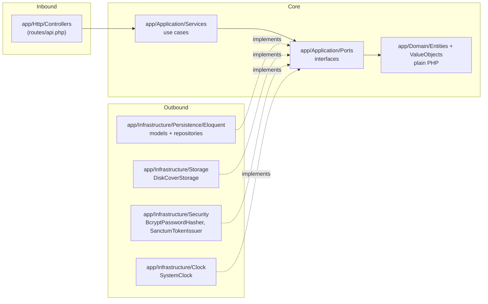
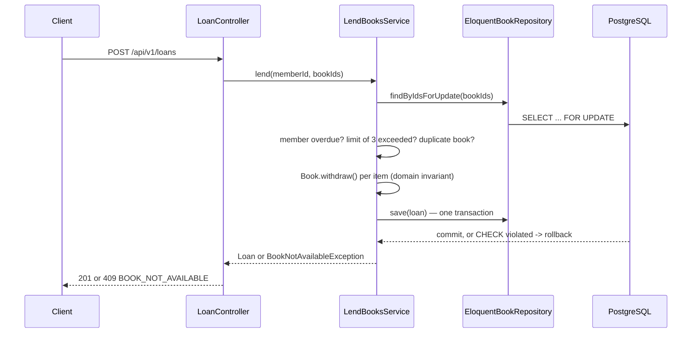

# Architecture — Manager Library (React + Laravel)

**Hexagonal** architecture (ports and adapters), same as the reference spec. The dependency rules are
Articles I to III of [`constitution.md`](constitution.md).

## 1. Layers and dependencies



Dependency arrows point **inward**. `app/Providers/AppServiceProvider.php` is the only place that sees both
halves (Article III).

## 2. Folder structure

```text
app/
├── Domain/
│   ├── Entities/          # Book, Member, User, Loan, LoanItem — plain PHP, no Eloquent
│   ├── ValueObjects/       # Isbn, Quantity, DateRange
│   └── Exceptions/         # BookNotAvailableException, MemberHasOverdueException, ...
├── Application/
│   ├── Ports/              # BookRepository, MemberRepository, UserRepository, LoanRepository,
│   │                       # CategoryRepository, ReportReader, Clock, PasswordHasher, TokenIssuer, CoverStorage
│   └── Services/           # LendBooksService, ReturnLoanItemService, LoginService, CreateLibrarianService,
│                           # SearchBooksService, CreateBookService, OverdueService, MostBorrowedReportService, ...
├── Infrastructure/
│   ├── Persistence/Eloquent/  # CategoryModel, BookModel, MemberModel, UserModel, LoanModel, LoanItemModel
│   │                          # + EloquentBookRepository, EloquentLoanRepository, ...
│   ├── Security/           # BcryptPasswordHasher, SanctumTokenIssuer
│   ├── Clock/               # SystemClock
│   └── Storage/             # DiskCoverStorage
├── Http/
│   ├── Controllers/         # one controller per contract resource
│   ├── Middleware/          # role-based authorization
│   └── Resources/           # JSON response shaping
└── Providers/AppServiceProvider.php   # the single composition point
```

## 3. Aggregates (invariants they defend)

| Entity | Invariants |
|---|---|
| `Book` | `available_copies` between 0 and `total_copies`; `total_copies` ≥ 1; soft delete via `deletedAt` |
| `Loan` + `LoanItem` | 1 to 3 items; no repeated book; 14-day due date; immutable except `returnedAt` |
| `Member` | document number required and unique |
| `User` | normalized username (lowercase, trimmed); role in (`admin`, `librarian`) |

`LendBooksService` withdraws the copy and creates the item **in a single transaction** (`DB::transaction`),
with `lockForUpdate()` on the book row to resolve the last-copy race (ADR-002).

## 4. Flow: register a loan



## 5. Errors

Services and entities throw their own domain exceptions (`BookNotAvailableException`,
`MemberHasOverdueException`, `MemberLimitExceededException`, ...), all extending `DomainException` with a
`code()` and `statusCode()`. A central exception handler (`bootstrap/app.php` → `withExceptions`) translates
them to the single error body from `api-contract.md`. A raw framework error (Eloquent, validation) never
reaches the client.

## 6. What is not here

No queues, no cache, no microservices, no multi-tenancy — same as the reference spec. Added only if a
requirement asks for it, not before.
