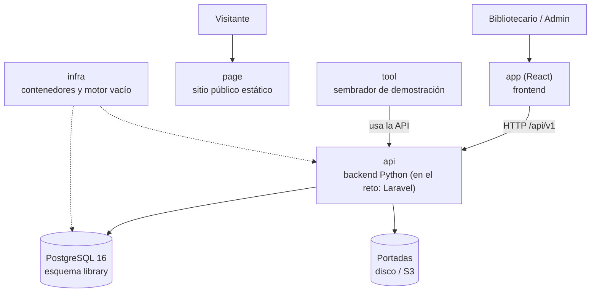

# Arquitectura en una página — Manager Library

Para leer en cinco minutos antes de abrir el resto. El detalle está en [`architecture.md`](architecture.md).

## El sistema en una imagen

## Los seis repositorios y su papel

| Repo | Papel | Se prueba con |
|---|---|---|
| `docs` | La especificación | Que esta lectura baste para construir |
| `api` | Reglas de negocio y contrato HTTP | Pruebas de dominio, aplicación, contrato y concurrencia |
| `app` | Pantallas de operación | Un recorrido de punta a punta: login → prestar → devolver → reporte |
| `page` | Presentación pública, sin llamar a la API | Que se vea bien en móvil y escritorio |
| `infra` | `docker compose up` y la base vacía | Que arranca con un solo comando |
| `tool` | Datos de demostración (libros, socios, préstamos) | Que la feria de presentación tenga datos reales |

## Las cinco ideas que sostienen el diseño

1. **El préstamo es un hecho inmutable**; solo cambia `returned_at` de una línea.
2. **Los ejemplares se descuentan y se devuelven dentro de la misma operación** que crea o cierra la línea.
3. **El estado se calcula**: `open`, `overdue` o `closed` no están en la base.
4. **Lo congelado no sigue al catálogo**: el reporte de octubre no cambia porque en noviembre se renombre un libro.
5. **La base es la última barrera**: si el `CHECK` de ejemplares salta, algo escribió fuera del sistema.
